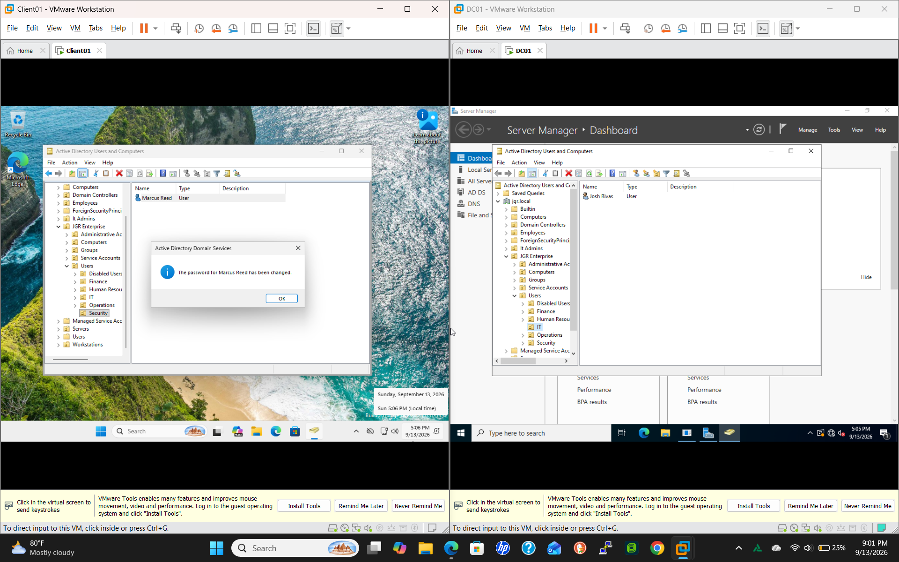
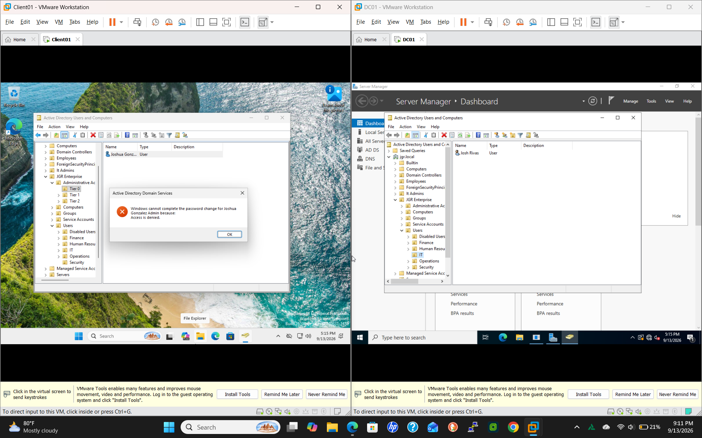
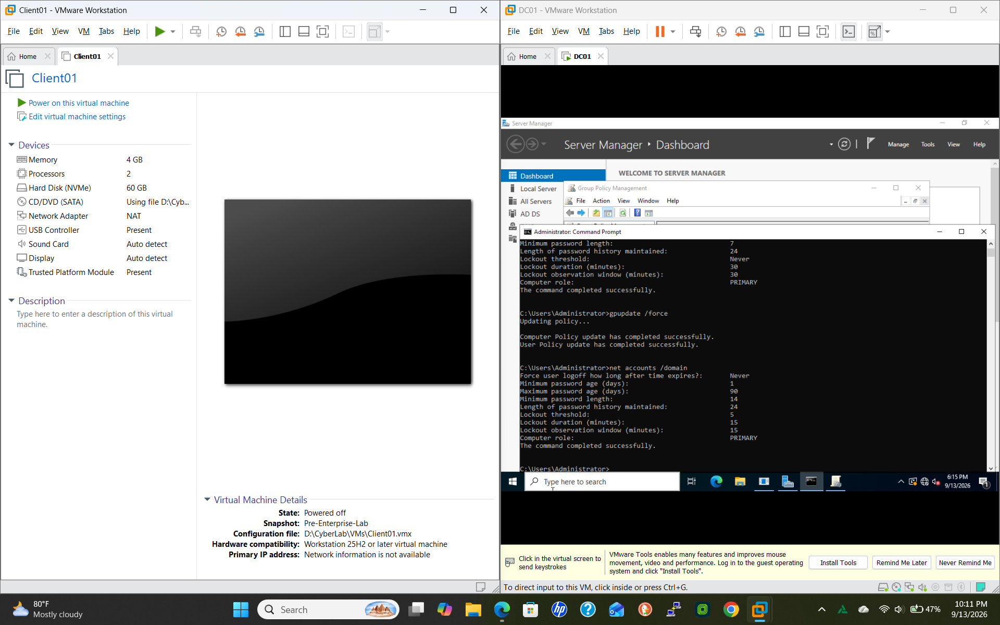
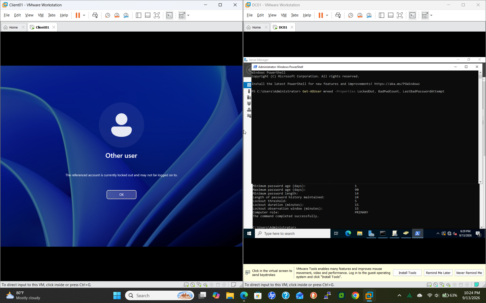
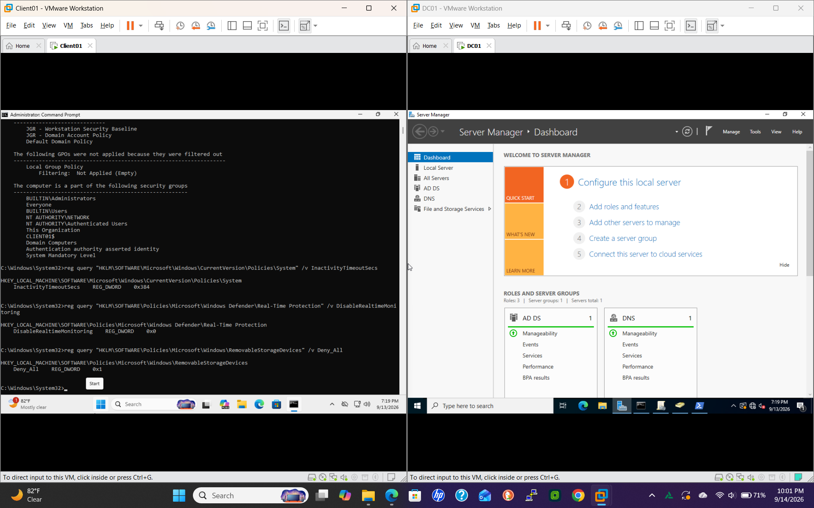
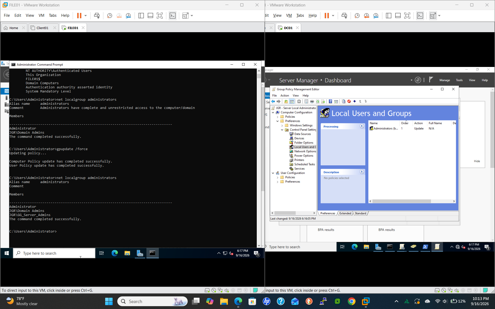
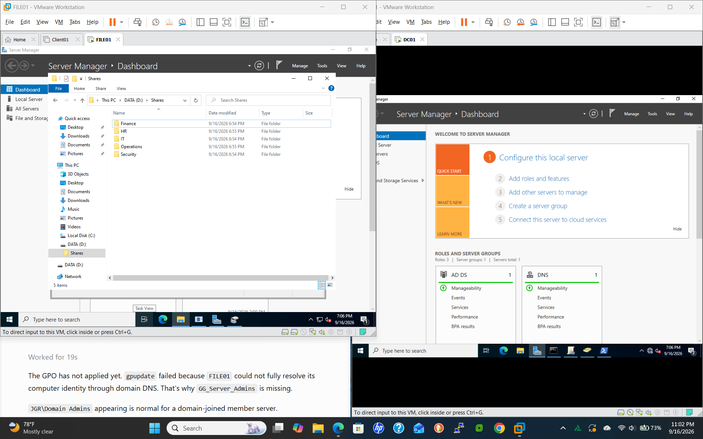
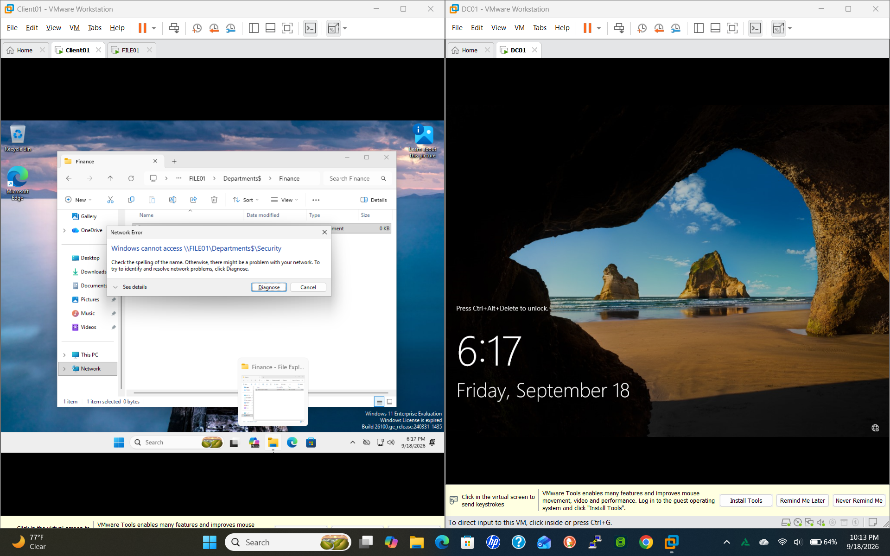

# Enterprise Active Directory, IAM & File Services Lab

**Joshua Gonzalez Rivas** · VMware · Windows Server 2022 · Windows 11

## Overview

I built a three-VM Windows domain to practice identity administration, delegated access, Group Policy, and secure departmental file services. This home lab developed skills relevant to IT support, systems administration, and IAM.

| System | Role |
| --- | --- |
| DC01 | Active Directory Domain Services and DNS |
| FILE01 | Departmental SMB services and File Server Resource Manager |
| CLIENT01 | Domain-joined Windows workstation for access and policy checks |

## Implementation

- AD DS, DNS, domain joins, tiered OUs, users, security groups, service and administrative accounts.
- RBAC, least privilege, and AGDLP: Accounts → Global groups → Domain Local groups → Permissions.
- Separate Tier 0 and Tier 1 administration and delegated Help Desk password reset/account unlock tasks.
- Account policies, workstation security GPOs, and server-local administrative access through Group Policy.
- Departmental SMB services on a dedicated NTFS volume, a hidden encrypted share, access-based enumeration, and group-based ACLs.
- FSRM 3 GB quotas, active executable-file screening, and event-log investigation.

The implementation summary comes from the completed lab record. The original screenshots below substantiate specific identity, policy and file-access checks; they do not independently prove every configuration listed above. Hidden shares still require authorization. SMB encryption protects transport and does not establish encryption at rest.

## Selected original evidence

Eight original screenshots were selected for clear results and useful context. Lab account names and the jgr.local domain are test-environment identifiers. Images retain their original contents.

### 1. Password reset succeeds

AD Users and Computers reports that the password for the test account Marcus Reed was changed. The OU hierarchy is visible. This message confirms a reset, but does not independently establish the acting account or complete delegation scope.

### 2. Password reset is denied

The same administrative console displays an access-denied response to a password-reset attempt. This provides evidence of an access boundary in the tested context, without establishing the full permission matrix.

### 3. Domain account policy is verified

After gpupdate /force, net accounts /domain shows a 14-character minimum password length, password history of 24, lockout threshold of five attempts, and 15-minute lockout duration/observation window. Earlier output above it records the prior values.

### 4. Account lockout is observed

CLIENT01 reports that the referenced account is locked out. A Get-ADUser diagnostic command is entered on DC01; this screenshot does not show its returned results.

### 5. Workstation policy checks

The output lists the workstation baseline and domain account-policy GPOs. Registry queries show InactivityTimeoutSecs = 0x384 (900 seconds), DisableRealtimeMonitoring = 0, and removable-storage Deny_All = 1. These are configuration checks, not a complete behavioral test of all protections.

### 6. Server administrator group membership

FILE01 shows the local Administrators membership before and after a policy refresh. The later listing includes JGR\GG_Server_Admins, alongside the Group Policy preference editor.

### 7. Departmental folders

FILE01 displays the departmental folder structure under D:\Shares. This shows the folders exist, rather than proving their individual ACLs or SMB settings.

### 8. Departmental access boundary

A client shows a Finance folder/file context while an attempted Security path returns a Windows cannot access message. This documents the observed access result; the screenshot alone does not isolate whether SMB permissions, NTFS permissions, or enumeration behavior caused it.

## Commands and further validation

- [Recovered command excerpts and troubleshooting notes](docs/recovered-lab-commands.md)
- [Validation and evidence checklist](docs/validation-and-evidence.md)

The command excerpts are walkthrough instructions, not a standalone script or fresh execution transcript. The checklist describes further evidence to capture. Original configuration exports and standalone scripts have not been added.

## Skills

Windows Server · Active Directory · DNS · IAM · RBAC · AGDLP · Group Policy · Delegation · SMB · NTFS permissions · FSRM · Troubleshooting · Documentation

## Next improvements

Capture share encryption, access-based enumeration, ACLs, FSRM quota/enforcement, and audit-event details directly from the VMs. Add tested automation with its actual output.

[GitHub](https://github.com/jgrivas0408-del) · [LinkedIn](https://www.linkedin.com/in/joshua-gonzalez-rivas-7857b6393)
